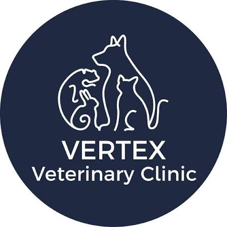

<div align="center">
  
  
  # VERTEX Veterinary Clinic
  ### Digital Storefront & Appointment Automation Case Study
  
  [](https://vertex-veterinary-clinic.vercel.app)
  [-F59E0B?style=for-the-badge&logo=googlemaps)](https://vertex-veterinary-clinic.vercel.app)
  [](https://vertex-veterinary-clinic.vercel.app)

  <p align="center">
    <strong>A high-converting, mobile-first web application featuring interactive appointment booking and a 24/7 conversational AI WhatsApp booking agent connected to Google Calendar.</strong>
  </p>

  <p align="center">
    <a href="https://vertex-veterinary-clinic.vercel.app"><strong>Explore Live Production Demo »</strong></a>
  </p>
</div>

---

## 📌 Executive Summary

**Client:** VERTEX Veterinary Clinic (PJ New Town, Petaling Jaya, Selangor)  
**Industry:** Veterinary Medicine & Companion Animal Healthcare (Dogs, Cats & Exotic Pocket Pets)  
**Solution Architect:** Shamir (MTPT Solutions)  

### The Challenge
VERTEX Veterinary Clinic is a highly rated veterinary practice in Petaling Jaya with a **4.8-star Google rating** from over 210 pet owners. Despite their stellar reputation, the clinic lacked an official web presence and was listed only on third-party directories (`klinikveterinar.my`), leaking potential clients to nearby competitors. 

Furthermore, clinic staff faced continuous telephone and WhatsApp message fatigue during busy surgery hours and after-hours (9:30 PM – 9:30 AM), leading to delayed booking confirmations and missed walk-ins.

### The Solution
MTPT Solutions engineered a dedicated digital storefront and automated booking pipeline tailored specifically to the clinic's real operating parameters:
1. **Owned Brand Real Estate**: Replaces directory listings with a bespoke, mobile-first web application.
2. **Interactive 4-Step Booking Wizard**: Captures pet species, clinical department, urgency level, vet doctor selection, and preferred time slots.
3. **24/7 AI WhatsApp Booking Agent**: Enables zero-form conversational bookings directly on WhatsApp with instant Google Calendar slot locking.
4. **Zero-Overhead Staff Workflow**: Integrates directly with the clinic's existing Google Calendar & Google Sheets at **RM 0/month software cost**.

---

## 🚀 Key Technical & UX Highlights

### 1. Mobile-First Horizontal Snap Carousels (`snap-x mandatory`)
Mobile users typically suffer from vertical "endless scroll" fatigue when browsing medical sites. This interface replaces tall single-column stacks with app-like horizontal snap carousels across Clinical Services, About Bento, Facility Gallery, Doctors, and Reviews—**cutting vertical scroll depth by ~65%**.

### 2. Specialized Veterinary Service Cards
Each service card features species indicators (`🐶 Dogs`, `🐱 Cats`, `🐰 Rabbits`, `🐹 Pocket Pets`), clinical turnaround tags (`⚡ Core Boosters`, `⏱️ Same-Day Lab Results`, `🩺 Gas Anesthesia`), and a live `Slots Open Today` status.

### 3. Interactive Glowing Edge Mesh Cards
Cards utilize a mathematical pointer-tracking engine (`--pointer-deg`, `--pointer-d`) with dynamic conic-gradient masks and radial mesh gradients to cast an interactive magnetic glow along the card edges on mouse movement.

### 4. Gooey Radio Slide Selection
The multi-step booking wizard uses an SVG liquid metaball filter (`feGaussianBlur` + `feColorMatrix`) that physically stretches the active Midnight Navy indicator dot like liquid goo between options before settling with an elastic jelly bounce.

### 5. Tactile 3D "Press Down" Buttons
All active buttons implement a tactile 3D base (`.btn-press-*`). On press (`:active`), the button sinks 5px into its darker shadow base, then springs back up on release with an elastic overshoot curve (`cubic-bezier(0.34, 1.85, 0.64, 1)`).

### 6. Dynamic Form Validation
Empty or improperly formatted fields trigger a horizontal input shake animation (`animate-input-shake`), a high-contrast red border (`border-rose-500`), and a smooth slide-down error message (`animate-error-slide`).

### 7. App-Style Sticky Mobile Bottom Bar
A fixed bottom action bar provides instant one-thumb access to the **24/7 WhatsApp Bot** and **Book Slot** wizard from any point on mobile screens.

---

## 🛠️ System Architecture

```
                       PET OWNER / VISITOR
                               │
               ┌───────────────┴───────────────┐
               ▼                               ▼
       Website Booking Form             24/7 WhatsApp AI Bot
     (Vite + React + Tailwind)       (Conversational Assistant)
               │                               │
               └───────────────┬───────────────┘
                               │
                               ▼
                   Cloud Automation Webhook
                               │
            ┌──────────────────┴──────────────────┐
            ▼                                     ▼
  Clinic Google Calendar                Clinic Google Sheet
  - Real-time slot locking              - Receptionist log & review
  - Prevents double-booking             - Contact records & symptoms
            │                                     │
            └──────────────────┬──────────────────┘
                               ▼
                 Automated Reminders (24h & 2h)
                 - Slashes client no-shows by 40%
```

---

## 💻 Tech Stack

* **Frontend Framework:** React 18, Vite 6
* **Styling & Design System:** Tailwind CSS 3.4 (Custom Vertex Navy & Linen Palette)
* **Icons & Assets:** Lucide React
* **Micro-Interactions:** SVG Metaball Filter, Conic-Gradient Mask Engine, CSS Keyframe Physics
* **Backend Automation:** Google Apps Script Webhook, Google Calendar API, Google Sheets API
* **Deployment & Edge CDN:** Vercel Global Edge Network (Singapore Edge Node)

---

## 🔒 Proprietary Code Notice

The live production application is publicly accessible at **[https://vertex-veterinary-clinic.vercel.app](https://vertex-veterinary-clinic.vercel.app)** for client preview and portfolio demonstration. 

The complete source code and automated backend infrastructure are proprietary to **MTPT Solutions**. 

---

## 📞 Agency & Business Inquiries

**MTPT Solutions**  
*Building modern digital storefronts and AI workflow automations for growing Malaysian SMEs.*

* **Developer & Founder:** Shamir (Sham)
* **Specialization:** High-Performance Web Apps, WhatsApp Business Automation & Google Workspace Integration
* **Live Demo:** [https://vertex-veterinary-clinic.vercel.app](https://vertex-veterinary-clinic.vercel.app)
